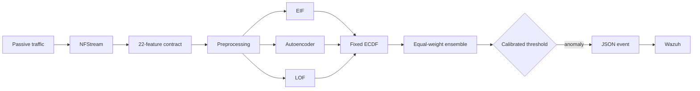

# Sensor IA NIDS

**Unsupervised network-flow anomaly detection with operational SIEM integration.**

[](https://github.com/schneider121203-oss/sensor-ia-nids_showcase/actions/workflows/verify.yml)


Sensor IA NIDS is a research prototype that converts passive network traffic
into bidirectional flows, scores each flow with three complementary
unsupervised detectors, and forwards prioritized anomaly events to Wazuh.

> This repository is a technical showcase. It intentionally excludes source
> code from the operational sensor, trained models, packet captures, datasets,
> credentials, network identifiers, and institutional material.

<p align="center">
  
</p>

## Why this system exists

Rule-based monitoring is effective for known indicators, but it can miss
unfamiliar or low-signature behavior. This system adds a flow-level anomaly
signal that does not require attack labels during model training. The output is
not an autonomous verdict: it is a prioritized event for analyst review in
Wazuh.

## Architecture



The detector uses:

- **Extended Isolation Forest (EIF)** for partition-based isolation.
- **Autoencoder (AE)** for reconstruction-error detection.
- **Local Outlier Factor (LOF)** for local-density deviation.
- **Fixed empirical CDFs** to map heterogeneous detector outputs to comparable
  anomaly percentiles.
- **Equal-weight fusion** to produce one ensemble score.

The implementation is designed for passive capture and CPU-only inference.
See [architecture.md](docs/architecture.md) for the component boundaries.

## Feature contract

Each NFStream flow is represented by a fixed contract of 22 fields:

| Group | Features |
|---|---|
| Core flow | `dur`, `proto`, `spkts`, `dpkts`, `sbytes`, `dbytes` |
| Packet / TTL | `sttl`, `dttl`, `is_sm_ips_ports` |
| 60-second context | `ct_dst_60s`, `ct_src_dport_60s`, `ct_dst_sport_60s`, `ct_dst_src_60s`, `ct_src_60s` |
| Derived rates | `flow_packet_rate`, `src_load_bps`, `dst_load_bps` |
| Derived ratios | `src_mean_packet_bytes`, `dst_mean_packet_bytes`, `bytes_ratio`, `packet_ratio`, `load_ratio` |

The explicit contract keeps offline training and live inference aligned. The
`ct_*` fields use time-based 60-second history rather than a global fixed count
of recent flows.

## Verified AWS evaluation

The reported evaluation contains **1,452 flow records** from an isolated AWS
laboratory: 908 attack-associated flows and 544 independently collected benign
flows. Offensive activity was authorized, controlled, and directed only at
laboratory-owned hosts.

| Metric | Result |
|---|---:|
| Recall | **95.48%** |
| Precision | **97.20%** |
| F1-score | **96.33%** |
| False-positive rate | **4.60%** |

### Confusion matrix

| Actual \ Predicted | Anomaly | Normal | Total |
|---|---:|---:|---:|
| Attack-associated | **867** | 41 | 908 |
| Benign | 25 | **519** | 544 |
| Total | 892 | 560 | **1,452** |

These values can be independently recalculated from the published counts:

```bash
python3 scripts/verify_metrics.py
```

Expected output:

```text
Recall:             95.48%
Precision:          97.20%
F1-score:           96.33%
False-positive rate: 4.60%
All published metrics verified.
```

## Evaluation discipline

- The learning protocol is **novelty detection trained on benign traffic**.
- Benign data was split chronologically into training, validation, and internal
  testing partitions.
- Score references were fitted from benign training data.
- The operating threshold was calibrated using benign validation traffic.
- Attack labels were used for retrospective evaluation, not detector training.
- Runs were kept intact; flows from one run were not randomly distributed
  between partitions.

Read the concise [methodology](docs/methodology.md) and the machine-readable
[metrics](data/metrics.json).

## Scope and limitations

The results above characterize controlled laboratory scenarios, including
network reconnaissance, TCP/UDP scanning, low-rate activity, SSH authentication
attempts, TTL variation, and combined evasion patterns. They are **not
production results** and should not be interpreted as a deployment-wide
detection guarantee.

Ground truth was assigned at run level. Flows from the same execution are
correlated, and one valid repetition was available per scenario. The raw
traffic and trained artifacts are not public, so this showcase verifies metric
arithmetic and documents the protocol; it does not claim full experimental
reproduction.

## Repository map

```text
.
├── assets/architecture.svg       Public system diagram
├── data/metrics.json             Structured verified counts and metrics
├── docs/architecture.md          Component and data-flow notes
├── docs/methodology.md           Experimental protocol and limitations
└── scripts/verify_metrics.py     Dependency-free metric verification
```

---

Built as an engineering research project at the intersection of network
security monitoring, unsupervised machine learning, and SIEM operations.
