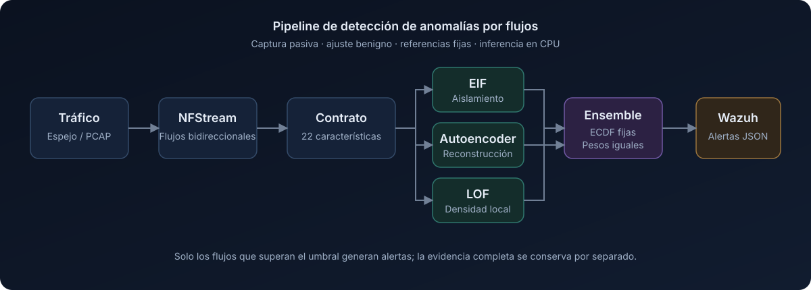
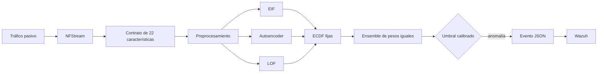

# Sensor IA NIDS

**Detección no supervisada de anomalías en flujos de red con integración operativa en SIEM.**

[](https://github.com/schneider121203-oss/sensor-ia-nids_showcase/actions/workflows/verify.yml)


Sensor IA NIDS es un prototipo de investigación que transforma tráfico de red
pasivo en flujos bidireccionales, evalúa cada flujo mediante tres detectores no
supervisados complementarios y envía eventos de anomalía priorizados a Wazuh.

> Este repositorio es un showcase técnico. Excluye deliberadamente el código
> fuente del sensor operativo, modelos entrenados, capturas de paquetes,
> datasets, credenciales, identificadores de red y material institucional.

<p align="center">
  
</p>

## Problema abordado

El monitoreo basado en reglas funciona bien ante indicadores conocidos, pero
puede omitir comportamientos nuevos o con pocas señales. Este sistema añade una
señal de anomalía por flujo que no requiere etiquetas de ataques durante el
entrenamiento. Su salida no es un veredicto autónomo: es un evento priorizado
para revisión por un analista en Wazuh.

## Arquitectura



El detector utiliza:

- **Extended Isolation Forest (EIF)** para aislamiento basado en particiones.
- **Autoencoder (AE)** para detectar errores de reconstrucción.
- **Local Outlier Factor (LOF)** para medir desviaciones de densidad local.
- **Funciones de distribución empírica fijas** para convertir scores
  heterogéneos en percentiles de anomalía comparables.
- **Fusión con pesos iguales** para producir un único score del ensemble.

La implementación está diseñada para captura pasiva e inferencia solo con CPU.
Consulta [arquitectura.md](docs/architecture.md) para conocer los límites entre
componentes.

## Contrato de características

Cada flujo de NFStream se representa mediante un contrato fijo de 22 campos:

| Grupo | Características |
|---|---|
| Flujo básico | `dur`, `proto`, `spkts`, `dpkts`, `sbytes`, `dbytes` |
| Paquetes y TTL | `sttl`, `dttl`, `is_sm_ips_ports` |
| Contexto de 60 segundos | `ct_dst_60s`, `ct_src_dport_60s`, `ct_dst_sport_60s`, `ct_dst_src_60s`, `ct_src_60s` |
| Tasas derivadas | `flow_packet_rate`, `src_load_bps`, `dst_load_bps` |
| Razones derivadas | `src_mean_packet_bytes`, `dst_mean_packet_bytes`, `bytes_ratio`, `packet_ratio`, `load_ratio` |

El contrato explícito mantiene alineados el entrenamiento fuera de línea y la
inferencia en vivo. Los campos `ct_*` utilizan historial temporal de 60 segundos
en lugar de un conteo global fijo de flujos recientes.

## Evaluación verificada en AWS

La evaluación publicada contiene **1 452 registros de flujo** de un laboratorio
AWS aislado: 908 flujos asociados a ataques y 544 flujos benignos recolectados
de manera independiente. La actividad ofensiva fue autorizada, controlada y
dirigida exclusivamente a equipos propios del laboratorio.

| Métrica | Resultado |
|---|---:|
| Recall | **95.48 %** |
| Precisión | **97.20 %** |
| F1-score | **96.33 %** |
| Tasa de falsos positivos | **4.60 %** |

### Matriz de confusión

| Real \ Predicción | Anomalía | Normal | Total |
|---|---:|---:|---:|
| Asociado a ataque | **867** | 41 | 908 |
| Benigno | 25 | **519** | 544 |
| Total | 892 | 560 | **1 452** |

Los valores pueden recalcularse independientemente desde los conteos publicados:

```bash
python3 scripts/verify_metrics.py
```

Salida esperada:

```text
Recall:                    95.48 %
Precisión:                 97.20 %
F1-score:                  96.33 %
Tasa de falsos positivos:   4.60 %
Todas las métricas publicadas fueron verificadas.
```

## Disciplina experimental

- El protocolo es **novelty detection entrenado con tráfico benigno**.
- Los datos benignos se dividieron cronológicamente en entrenamiento,
  validación y prueba interna.
- Las referencias de scores se ajustaron con entrenamiento benigno.
- El umbral operativo se calibró con tráfico benigno de validación.
- Las etiquetas de ataques se utilizaron para evaluación retrospectiva, no para
  entrenar los detectores.
- Las ejecuciones se mantuvieron intactas; los flujos de una misma corrida no se
  distribuyeron aleatoriamente entre particiones.

Consulta la [metodología resumida](docs/methodology.md) y las
[métricas estructuradas](data/metrics.json).

## Alcance y limitaciones

Los resultados caracterizan escenarios controlados de laboratorio, incluyendo
reconocimiento de red, escaneo TCP/UDP, actividad de baja tasa, intentos de
autenticación SSH, variaciones de TTL y patrones combinados de evasión. **No son
resultados de producción** ni deben interpretarse como una garantía de detección
para un despliegue completo.

El ground truth se asignó por corrida. Los flujos de una misma ejecución están
correlacionados y solo se dispuso de una repetición válida por escenario. El
tráfico original y los artefactos entrenados no son públicos; por tanto, este
showcase verifica la aritmética de las métricas y documenta el protocolo, pero
no afirma una reproducción experimental completa.

## Estructura del repositorio

```text
.
├── assets/architecture.svg       Diagrama público del sistema
├── data/metrics.json             Conteos y métricas verificadas
├── docs/architecture.md          Componentes y flujo de datos
├── docs/methodology.md           Protocolo experimental y limitaciones
└── scripts/verify_metrics.py     Verificación sin dependencias externas
```

---

Proyecto de ingeniería e investigación en la intersección del monitoreo de
seguridad de redes, aprendizaje no supervisado y operaciones SIEM.
