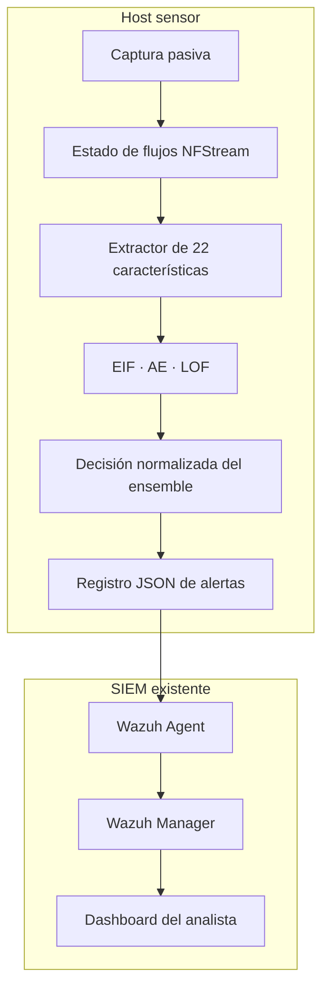

# Arquitectura

## Flujo de procesamiento

1. **Adquisición pasiva** — se observa una interfaz espejada autorizada o una
   fuente PCAP sin modificar el tráfico de red.
2. **Construcción de flujos** — NFStream convierte paquetes en registros de
   flujos bidireccionales.
3. **Extracción de características** — el sensor produce un contrato estable de
   22 características, incluyendo valores directos, tasas y razones derivadas,
   y contadores contextuales explícitos de 60 segundos.
4. **Preprocesamiento** — el protocolo categórico y los campos numéricos se
   transforman mediante artefactos ajustados exclusivamente en entrenamiento.
5. **Scoring independiente** — EIF, AE y LOF producen scores de anomalía desde
   perspectivas geométricas complementarias.
6. **Normalización** — distribuciones empíricas inmutables convierten los scores
   en percentiles comparables. Un flujo nunca se ordena contra el lote que está
   llegando en ese momento.
7. **Fusión y decisión** — los tres percentiles se promedian con pesos iguales y
   se comparan con un umbral calibrado sobre validación benigna.
8. **Integración SIEM** — los flujos anómalos generan eventos JSON estructurados,
   consumidos por un Wazuh Agent y evaluados mediante reglas de Wazuh.

## Límites de confianza

El showcase omite direcciones operativas, reglas, servicios systemd,
certificados, credenciales, artefactos entrenados y configuración de despliegue.

## Propiedades de ejecución

- Inferencia solo con CPU, sin dependencia de GPU.
- Selección explícita de la interfaz de captura.
- Orden fijo de características y metadatos del modelo.
- Distribuciones de referencia de scores fijas.
- Eventos estructurados compatibles con el análisis del SIEM.
- Registro de todos los flujos separado del envío exclusivo de alertas.
