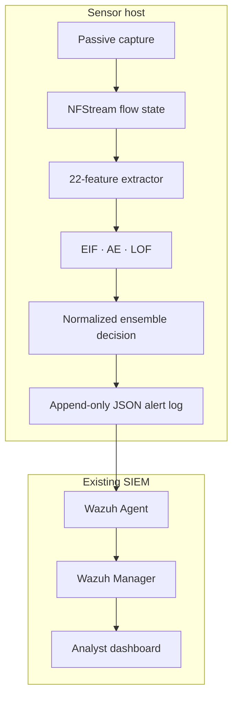

# Architecture

## Processing path

1. **Passive acquisition** — an authorized mirrored interface or PCAP source is
   observed without modifying network traffic.
2. **Flow construction** — NFStream converts packets into bidirectional flow
   records.
3. **Feature extraction** — the sensor produces a stable 22-feature contract,
   including direct flow values, derived rates and ratios, and explicit
   60-second contextual counters.
4. **Preprocessing** — categorical protocol values and numerical features are
   transformed using training-fitted artifacts.
5. **Independent scoring** — EIF, AE, and LOF produce anomaly scores from
   complementary geometric perspectives.
6. **Score normalization** — immutable empirical score distributions convert
   raw outputs into comparable percentiles. A flow is never ranked against the
   current live batch.
7. **Fusion and decision** — the three percentiles are averaged with fixed equal
   weights and compared with a threshold calibrated on benign validation data.
8. **SIEM integration** — anomalous flows become structured JSON events consumed
   by a Wazuh Agent and evaluated by Wazuh rules.

## Trust boundaries

The showcase omits operational addresses, rules, service units, certificates,
credentials, trained artifacts, and deployment configuration.

## Runtime properties

- CPU-only inference; no GPU dependency.
- Explicit capture-interface selection.
- Fixed feature ordering and model metadata.
- Fixed score-reference distributions.
- Structured event output suitable for SIEM parsing.
- Full-flow logging is separated from alert-only forwarding.
